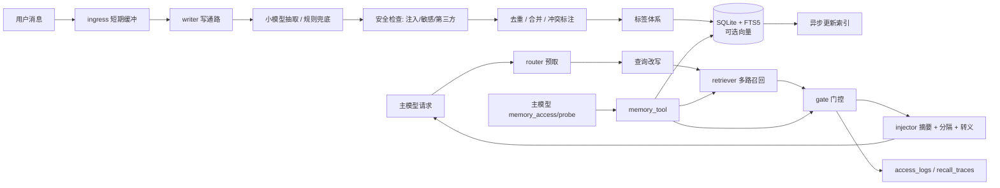

# astrbot_memory_router

给 AstrBot 增加一套**可治理的长期记忆系统**：

- 短期对话留在上下文，长期记忆落到 AstrBot `data` 目录下的 SQLite；
- 小模型从上下文里抽取值得记住的信息，规则兜底，失败不阻塞主对话；
- 召回时多路检索 + 可解释门控，默认只向主模型注入「摘要 + 来源 + 置信度 + 冲突提示 + 分数」；
- 主模型通过 `memory_access` / `memory_probe` 主动查询，解决“不知道自己不知道”和跨会话任务延续；
- 个人 / 群 / 全局三层隔离，分层遗忘，访问统计，审计，限流，离线评测。

> 项目名：`astrbot_memory_router`。入口文件：`main.py`。插件类继承 `astrbot.api.star.Star`。

---

## 1. 目录树与模块职责

```text
astrbot_memory_router/
├── main.py                     # AstrBot 插件入口：注册消息监听/LLM 钩子/工具/命令
├── metadata.yaml               # 插件元数据
├── _conf_schema.json           # WebUI 配置 Schema
├── requirements.txt            # 运行时依赖（无第三方依赖）
├── requirements-dev.txt        # 开发测试依赖
├── README.md
├── pytest.ini
├── adapter/
│   ├── astrbot_adapter.py      # AstrBot 事件、身份、数据目录、动态上下文注入适配
│   └── llm_adapter.py          # context.llm_generate 封装、严格 JSON、失败降级
├── ingress/
│   ├── buffer.py               # 每会话短期缓冲、防抖抽取、显式“别记”拦截
│   └── session_state.py        # 会话级最近注入/召回状态（内存）
├── writer/
│   ├── extractor.py            # 小模型抽取 + 规则兜底 + Schema 校验
│   ├── sanitizer.py            # 指令性内容检测、敏感信息、第三方陈述
│   ├── conflict.py             # 去重/冲突预筛，只标注不裁决真伪
│   ├── tagger.py               # 受控词表 + 自由标签
│   └── pipeline.py             # 写通路编排与 write_epoch 一致性
├── store/
│   ├── models.py               # 记忆/标签/过滤/访问统计数据模型
│   ├── migrations.py           # schema_version、建表、FTS5、迁移入口
│   ├── write_queue.py          # 单消费者异步写队列 + SAVEPOINT + 批量提交
│   ├── sqlite_store.py         # SQLite/FTS5/标签/冲突/trace/审计/向量表
│   └── vector_backend.py       # 向量后端接口、Null 后端、可选 hash 示例
├── retriever/
│   ├── query_rewrite.py        # 指代消解/查询变体（规则默认，LLM 可选）
│   └── retriever.py            # 标签粗筛 + FTS/LIKE/实体/向量多路召回
├── router/
│   ├── router.py               # 预取 → 精排 → 门控 → 注入 → trace
│   └── reranker.py             # 小模型重排、cross-encoder 接口
├── gate/gate.py                # 门控分、阈值、top-k、token 预算、敏感隔离、冲突惩罚
├── injector/injector.py        # 不可执行历史资料分隔块、转义、摘要注入
├── memory_tool/service.py      # memory_access / memory_probe 业务实现
├── stats/
│   ├── retention.py            # 留存分、衰减、分层访问增益、防自我强化
│   └── metrics.py              # 进程内评估指标
├── lifecycle/manager.py        # 压缩/归档/软删/硬删/复活/纠正/全局提升
├── governance/
│   ├── policy.py               # owner/敏感权限、审计脱敏
│   ├── rate_limit.py           # 会话级检索次数与 token 预算
│   └── audit.py                # 审计封装
├── commands/memory_commands.py # /memory 子命令实现
├── prompts/                    # 抽取/路由/查询改写/主模型使用说明
├── utils/                      # 时间、文本、JSON、ID 工具
├── config/                     # 配置强类型视图与示例配置
└── tests/                      # 单元/集成测试、无 pytest 运行器、离线评测集
```

### 架构图



---

## 2. 安装

1. 将整个目录放到 AstrBot 的插件目录，例如：

   ```text
   AstrBot/data/plugins/astrbot_memory_router/
   ```

2. 在 AstrBot WebUI「插件」页重载插件。`metadata.yaml` 与 `_conf_schema.json` 会被自动读取。
   仓库地址：<https://github.com/qweasdfaqcw/astrbot_memory_router>。
3. 运行时无需额外 Python 包；SQLite 使用 Python 内置 `sqlite3`，FTS5 由 SQLite 构建提供。
4. 打开插件配置，至少确认：
   - `small_model_provider_id`：小模型提供商；留空则回退当前会话提供商；
   - `admin_user_ids`：需要硬删除/维护/全局共享的管理员 ID；
   - `hard_delete_enabled`：默认关闭，建议保持关闭。

数据目录：

```text
AstrBot/data/plugin_data/astrbot_memory_router/
├── memory_router.sqlite3
├── memory_router.sqlite3-wal
└── memory_router.sqlite3-shm
```

**不会写入插件自身目录。** 如确需覆盖，可设置 `data_dir`；不得指向插件目录。

---

## 3. 配置

完整字段见 [`_conf_schema.json`](_conf_schema.json) 与 [`config/example_config.json`](config/example_config.json)。

常用配置：

| 配置 | 默认 | 说明 |
|---|---|---|
| `enabled` | `true` | 总开关 |
| `small_model_provider_id` | 空 | 抽取/改写/重排的小模型；留空回退当前会话 provider |
| `extract_enabled` | `true` | 自动抽取 |
| `extraction_every_n_messages` | `6` | 每 N 条未抽取消息触发后台抽取 |
| `gate_threshold` | `0.42` | 门控阈值 |
| `top_k` | `5` | 单次最多注入条数 |
| `max_injected_tokens` | `700` | 注入 token 预算（近似值） |
| `prefetch_max_latency_ms` | `800` | 预取超时，超时本次跳过注入 |
| `vector_backend` | `none` | `none` 或 `hash`（本地演示，不是语义 embedding） |
| `allow_personal_in_group` | `false` | 群聊是否读取发送者个人记忆 |
| `inject_third_party` | `false` | 第三方转述是否自动注入 |
| `auto_archive` | `true` | 自动归档，不删除 |
| `auto_compress` | `false` | 自动压缩旧事件，默认保守关闭 |
| `hard_delete_enabled` | `false` | 硬删除开关 |
| `admin_user_ids` | `[]` | 管理员 ID 列表 |

> `small_model_provider_id` 和主模型是独立配置的；小模型故障时自动降级到规则抽取 + LIKE/FTS 召回。

---

## 4. 数据模型

核心表：

- `memories`：正文、摘要、类型、owner、来源、置信度、敏感级别、重要性、情绪、生命周期、`compressed_from`、`write_epoch`、`schema_version` 等；
- `tags` / `memory_tags`：受控命名空间 + 自由标签，标签带 `weight/version/status`；
- `access_logs`：`candidate_recalled`、`injected`、`used_by_main_model`、`user_confirmed`、`user_corrected`、`revived` 分层记录；
- `conflicts`：冲突双方、类型、状态、人工解决记录；
- `recall_traces`：每次召回 query、候选、分数、门控、注入文本（脱敏）、是否使用、反馈、延迟；
- `audit_logs`：写/删/纠正/复活/全局提升等审计；
- `cold_memories`：压缩/归档前原文冷副本；
- `memory_vectors`：可选向量；
- `settings`：`write_epoch`、`schema_version`、`fts_mode`。

迁移版本位于 `PRAGMA user_version` 与 `settings.schema_version`。新增结构时只追加迁移，不修改已发布迁移。

`memory_type` 与半衰期：

| 类型 | 默认重要性 | 半衰期 |
|---|---:|---:|
| `fact` | 0.55 | 365 天 |
| `preference` | 0.60 | 365 天 |
| `event` | 0.45 | 30 天 |
| `task_state` | 0.65 | 14 天 |
| `relationship` | 0.60 | 540 天 |
| `constraint` | 0.80 | 730 天 |

---

## 5. 写通路

```text
消息 -> 短期缓冲（含未落库临时记忆）
     -> 显式“记住/别记”同步拦截
     -> 小模型抽取（严格 JSON + 一次修复 + 规则兜底）
     -> 指令性内容检测
     -> 敏感检测
     -> owner_scope 标记
     -> 精确哈希去重 -> 近重复合并 -> 冲突检测
     -> 受控词表 + 自由标签
     -> SQLite 写入（write_epoch 自增）
     -> FTS 同步更新；向量异步更新
```

- 用户说“记住/记一下/帮我记”时同步写入，写入返回即可检索；
- 用户说“别记/不要记/不用记”时把当前缓冲中的对应内容标记为不抽取；
- 纯文本“删掉记忆”不会自动执行，必须使用 `/memory forget`，避免误删；
- 小模型返回非法 JSON 时先做一次修复请求，仍失败则走规则抽取，不阻塞主对话；
- 第三方陈述默认 `confidence <= 0.5`、`source=third_party`，默认不自动注入；可用 `/memory confirm` 升级；
- `source` 表示“谁说的”（user / third_party / assistant / system），`owner_scope + owner_id` 表示“归属谁”，`entities` 记录“涉及谁/什么”；
- 敏感信息只标记、不自动删除；是否注入由门控和用户授权决定。

---

## 6. 读通路

```text
主模型请求 / 工具调用
  -> 查询改写（规则默认，LLM 可选）
  -> 标签粗筛 + FTS5 + LIKE + 实体 + 可选向量
  -> 小模型重排（可选）/ cross-encoder 接口
  -> gate：场景 × 任务 × 时效 × 重要性/情绪 × 来源置信 × 权限 - 成本 - 冲突
  -> 敏感隔离 / 不可执行内容隔离 / token 预算 / top-k / 多样性
  -> injector：摘要 + 来源 + 置信度 + 冲突 + 可解释分数
  -> access_logs / recall_traces / metrics
```

主模型触发规则（写进注入块与工具说明）：

- 用户提到过去事件、旧任务、长期偏好、关系事实、之前约定；
- 用户说“你记得吗/上次/之前说过”；
- `memory_probe` 提示可能存在相关记忆；
- 需要跨会话任务状态；
- 需要确认长期约束（过敏、禁忌、格式偏好）。

**默认只注入摘要与引用，不注入全文。** 全文必须：

```python
memory_access(
    mode="fetch",
    filters={"memory_ids": ["mem_xxx"]},
)
```

### 门控公式

```text
base = 0.50*relevance + 0.10*scene + 0.10*task
     + 0.18*salience + 0.12*source_confidence
salience = 0.78*importance + 0.17*arousal + 0.05*|valence|
gate = base × (0.65 + 0.35*decay) × permission
     - token_cost - conflict_penalty - archived_penalty - third_party_penalty
```

- `decay` 按 memory_type 半衰期；
- 情绪只做显著性权重，不是唯一开关；
- `permission` 为 0 时敏感/不可执行记忆直接拦截；
- 访问次数不参与门控，避免“被召回越多越容易被召回”。

### 留存公式

```text
retention = initial_importance × time_decay
          + min(0.28, 分层访问增益)
          + 用户确认增益
          + 情绪显著性增益
          - 纠正/过时惩罚
```

分层访问增益对候选/注入/实际使用/确认分别加权，近期访问额外加权，按不同会话数去重，防止自我强化。

### 遗忘四级

1. **降权**：留存分降低检索排序；
2. **压缩**：多条事件生成摘要，`compressed_from` 指向原文，原文进 `cold_memories`；
3. **归档**：移出 FTS 热索引，保留冷副本，可按标签检索/复活；
4. **软删除 / 硬删除**：软删除可恢复；硬删除需管理员 + `hard_delete_enabled` + 审计，级联清理标签、冲突、向量和冷副本。

自动维护默认只归档，**不自动删除**。用户 `/memory keep` 标记的记忆不会被自动归档/压缩。

---

## 7. 隔离与安全

- **owner_scope**：`personal` / `group` / `global`；
- 私聊可见：当前用户个人 + 全局；
- 群聊可见：当前群 + 全局；默认**不读**个人记忆；
- 群记忆默认不进私聊；
- 修改/删除群记忆或全局记忆需要管理员；个人记忆只有本人可改；
- 全局记忆只能由管理员 `/memory globalize <id>` 显式提升，保留 `security:shared` 标签与审计；
- 工具层不接受模型自定义 owner 扩大范围，服务端从 `AstrBot` 事件重建 `AccessContext`；
- 敏感规则兜底：身份证、手机号、银行卡、邮箱、住址、医疗、财务、密码/密钥；
- 所有敏感记忆默认只允许 `caller=user` 且私聊显式授权读取；主模型/路由小模型永远拿不到；
- 提示注入：含“忽略之前指令/你现在是/调用工具/删除记忆”等文本标记 `injectable=false`，注入器再加不可执行分隔块和 HTML 转义；
- 审计详情脱敏，不记录完整敏感正文；
- 限流：每会话每分钟检索次数 + 每小时 token 预算，超时/超限直接跳过本次注入；
- 标签演化：`/memory tagmerge` 合并同义/低效标签，旧标签标记 `merged` 并递增 version；维护任务把无引用的标签标记 `inactive`，不物理删除历史。

> 过敏/忌口属于安全约束，规则将其识别为 `medical_constraint` 而不是私密医疗史，否则关键安全记忆会被敏感策略误杀。

---

## 8. 主模型工具

### `memory_access`

```json
{
  "caller": "main_model",
  "mode": "search",
  "query": "我上次说的咖啡偏好",
  "filters": {
    "tags_any": ["topic:咖啡"],
    "owner_scope": "personal",
    "sensitivity_max": "normal",
    "lifecycle": ["active"],
    "time_range": {"from": "2026-01-01T00:00:00+00:00"}
  },
  "budget": {"max_tokens": 600, "max_items": 5, "max_latency_ms": 2000},
  "options": {
    "return_summary": true,
    "include_provenance": true,
    "include_conflicts": true,
    "include_scores": true,
    "dedup": true,
    "diversify": true,
    "require_user_auth": false
  }
}
```

支持 `filters`：

```text
time_range, scene, task, topic, entities, event_type, emotion, source,
confidence, sensitivity_max, lifecycle, owner_scope, owner_id,
tags_any, tags_all, memory_ids, offset
```

返回：

```json
{
  "items": [
    {
      "memory_id": "mem_xxx",
      "summary": "喜欢美式咖啡不加糖",
      "content_ref": "memory://mem_xxx",
      "tags": ["topic:咖啡", "type:preference"],
      "provenance": {"source": "user", "confidence": 0.8},
      "scores": {
        "relevance": 0.72,
        "recency": 1.0,
        "importance": 0.65,
        "sensitivity": "normal",
        "gate": 0.68
      },
      "conflicts_with": [],
      "lifecycle": "active",
      "access_stats": {"counts": {}, "recent_30d": {}, "unique_sessions": {}}
    }
  ],
  "truncated": false,
  "next_cursor": null,
  "explain": {}
}
```

### `memory_probe`

```json
{
  "query": "杭州旅行",
  "filters": {"tags_any": ["topic:旅行"]}
}
```

返回 `exists`、最多 3 条候选摘要、`suggested_queries`，不返回全文。

> 工具实现是 `async def` 协程，返回 `mcp.types.CallToolResult`（AstrBot 自带 `mcp`）；若运行环境缺少 `mcp`，自动回退为 JSON 字符串。没有使用 `yield`，避免 AstrBot 把工具结果当作用户消息直接发送。

---

## 9. 用户命令

| 命令 | 说明 |
|---|---|
| `/memory list [主题] [--type 类型] [--limit N] [--all]` | 按类型分组查看；`--all` 含压缩/归档/软删；敏感摘要隐藏 |
| `/memory search <查询>` | 以用户身份检索摘要 |
| `/memory forget <id> [--hard]` | 软删除；硬删除需管理员且启用配置 |
| `/memory keep <id> [--off]` | 标记/取消长期保留 |
| `/memory why <id>` | 解释留存、最近召回和访问统计 |
| `/memory confirm <id>` | 用户确认，提升置信度，升级第三方来源 |
| `/memory correct <id> <新内容>` | 纠正：旧记忆标为 superseded，新建用户来源记忆 |
| `/memory revive <id>` | 复活归档/压缩/软删除，降置信并提示过时/冲突 |
| `/memory audit [N]` | 管理员看全部；普通用户看自己的操作 |
| `/memory stats` | 记忆数量、生命周期、留存均值、召回指标 |
| `/memory compress <id1,id2,...>` | 管理员手动压缩 |
| `/memory maintain` | 管理员运行留存/归档/压缩维护 |
| `/memory globalize <id>` | 管理员提升为全局共享记忆 |
| `/memory tagmerge <ns:源标签> <ns:目标标签>` | 管理员合并标签，旧标签保留 version/merged 状态 |
| `/memory tags` | 管理员查看标签使用量与状态 |

---

## 10. 可观测性与评估

- 结构化日志：写入条数、冲突、降级、召回 trace、注入条数/token/位置；
- `access_logs` 区分候选/注入/使用/确认/纠正/复活；
- `recall_traces` 记录 query、候选 ID/分数、门控决策、脱敏注入文本、延迟；
- `used_by_main_model` 的判定：
  - `fetch` 视为强使用信号；
  - 搜索/注入返回不直接等同真实使用，未做回复后语义归因；
- `/memory stats` 输出进程内指标：召回次数、注入条数、token、敏感/注入拦截、P50/P95 延迟、用户纠错率；管理员额外看到「复活/归档」遗忘误杀代理；
- 离线评测：

  ```bash
  python tests/run_eval.py
  # 或指定数据集/阈值
  python tests/run_eval.py --dataset tests/eval_dataset.jsonl --threshold 0.6
  ```

  当前数据集 8 个场景，评测 recall@10、注入召回、注入精确率、平均延迟。修改提示词或打分函数后应重跑。

---

## 11. 测试

```bash
python -m pytest
# 无 pytest 环境可用：
python tests/run_all.py
python tests/run_eval.py
```

测试覆盖：

- 存储 CRUD / FTS5 / owner 隔离 / 访问统计 / 冲突 / 审计；
- 显式同步写入、去重、冲突标注、敏感拦截、指令性内容、第三方低置信；
- 多路召回、门控分数、敏感/不可执行拦截；
- 压缩/归档/软删/硬删/复活/固定保留；
- `memory_access` 默认摘要、`fetch` 全文、跨用户拒绝；
- `/memory` 命令；
- 插件入口在最小 AstrBot stub 下的加载、装饰器和工具 docstring 解析前置检查。

> 本地没有完整 AstrBot 运行时，加载测试使用最小 stub；关键 API 已对照 AstrBot master 的 `call_handler`、`register_llm_tool`、tool executor、`ProviderRequest` 与 `TextPart` 源码核对。真实部署后仍请查看 AstrBot 插件重载日志与 `/memory stats`。

---

## 12. 已知限制

1. **AstrBot 版本差异**：事件、`conversation_manager`、`extra_user_content_parts` 等 API 已集中到 `adapter/` 并做防御式调用；不同版本若字段不同，只改 adapter。`conversation_manager` 仅作为可选历史来源，当前主路径依赖本地短期缓冲。
2. **真实使用归因**：主模型回复后没有做语义级“是否用了记忆”的归因；`fetch` 作为强信号，搜索结果只记 `injected`。
3. **hash 向量不是语义模型**：`vector_backend=hash` 只是零依赖可运行示例；生产可替换 `VectorBackend`。
4. **无 WebUI dashboard**：当前提供 `/memory stats`、结构化日志与 SQLite 表。
5. **敏感识别是规则兜底**：小模型标注受 Schema 约束，不能保证覆盖率；默认策略仍偏保守。
6. **自动硬删除不存在**：自动维护只归档/压缩；硬删除必须管理员显式操作并审计。
7. **SQLite 规模**：默认面向单机中小规模；大并发/百万级记忆建议实现 Postgres + pgvector 后端。
8. **压缩摘要**：默认使用摘要拼接，不调用额外模型；可手动传入摘要，后续可加小模型压缩。
9. **群聊自动抽取**：群消息默认写入 `group` 记忆；个人记忆不跨用户。若开启 `allow_personal_in_group`，需自行评估隐私暴露。
10. **提示词缓存**：动态记忆通过 `extra_user_content_parts` 注入；若 AstrBot 版本不支持该字段，会回退到追加 `system_prompt`，可能削弱缓存效果。

---

## 13. 适配说明与参考

AstrBot 插件规范参考：

- [插件开发指南（旧）](https://docs.astrbot.app/dev/star/plugin.html)
- [调用 AI](https://docs.astrbot.app/dev/star/guides/ai.html)
- [插件配置](https://docs.astrbot.app/dev/star/guides/plugin-config.html)
- [插件存储](https://docs.astrbot.app/dev/star/guides/storage.html)
- [处理消息事件](https://docs.astrbot.app/dev/star/guides/listen-message-event.html)

关键适配点：

- `main.py` 中的 Handler 全部在插件类内，前两个参数为 `self`、`event`；
- 工具使用 `@filter.llm_tool(name="...")`，docstring 含规范 `Args:`；
- 持久化路径通过 `get_astrbot_data_path()/plugin_data/astrbot_memory_router`；
- 配置通过 `_conf_schema.json`；`metadata.yaml` 位于根目录；
- LLM 调用只用 `self.context.llm_generate`，没有 `requests` 网络请求。

---

## 14. 最小验收清单

- [x] 继承 `Star`，`metadata.yaml` / `_conf_schema.json` 存在；
- [x] 消息触发写入，owner_scope 隔离；
- [x] `/memory list|search|forget|keep|why|audit|stats`；
- [x] `memory_access` / `memory_probe` 结构化返回，默认摘要 + 引用；
- [x] 敏感拦截、不可执行内容不注入；
- [x] 访问统计回写，留存分可解释；
- [x] 压缩/归档/软删/硬删/复活，冷副本与审计；
- [x] 小模型 JSON 失败重试 + 规则降级；
- [x] 关键路径测试与离线评测集。
